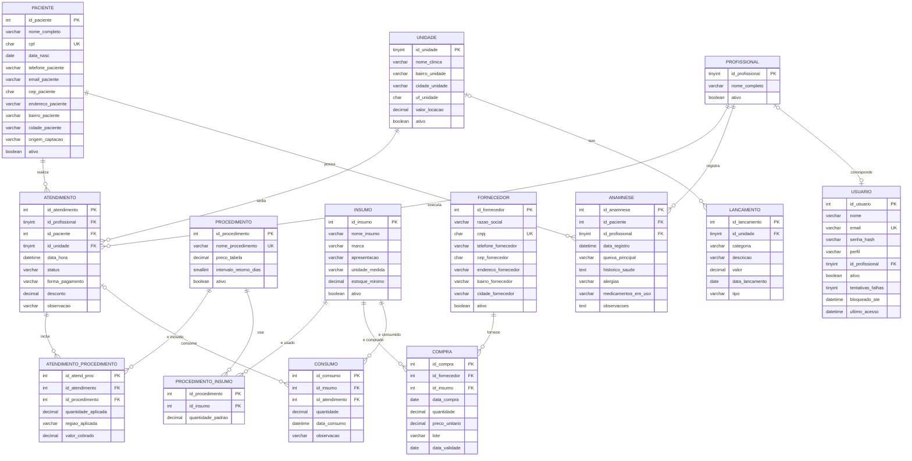

# Zenith - Modelo de dados (versão 2.0)

Banco MySQL 8, conjunto de caracteres utf8mb4. Script: `zenith_banco.sql`.

Convenções usadas em todo o modelo:

- Chave primária substituta inteira (`id_...`) em todas as entidades;
  `procedimento_insumo` usa chave composta (id_procedimento, id_insumo).
- `criado_em` e `atualizado_em` em todas as tabelas (auditoria e futura versão web).
- Exclusão lógica (`ativo`) em paciente, usuario, insumo, procedimento, unidade,
  fornecedor e profissional. Nenhum cadastro é apagado fisicamente.
- Regras garantidas pelo próprio banco (CHECK, FK, UNIQUE e gatilhos de saldo),
  não só pelo aplicativo.
- Nenhuma senha é guardada em texto: `usuario.senha_hash` guarda o hash bcrypt.

---

## 1. Entidades e atributos

Atributos listados dentro de cada entidade. PK = chave primária,
FK = chave estrangeira, UQ = valor único.

**UNIDADE**
- id_unidade (PK)
- nome_clinica (UQ)
- bairro_unidade
- cidade_unidade
- uf_unidade
- valor_locacao
- ativo
- criado_em
- atualizado_em

**PROFISSIONAL**
- id_profissional (PK)
- nome_completo
- ativo
- criado_em
- atualizado_em

**PACIENTE**
- id_paciente (PK)
- nome_completo
- cpf (UQ)
- data_nasc
- telefone_paciente
- email_paciente
- cep_paciente
- endereco_paciente
- bairro_paciente
- cidade_paciente
- origem_captacao
- ativo
- criado_em
- atualizado_em

**PROCEDIMENTO**
- id_procedimento (PK)
- nome_procedimento (UQ)
- preco_tabela
- intervalo_retorno_dias
- ativo
- criado_em
- atualizado_em

**FORNECEDOR**
- id_fornecedor (PK)
- razao_social
- cnpj (UQ)
- telefone_fornecedor
- cep_fornecedor
- endereco_fornecedor
- bairro_fornecedor
- cidade_fornecedor
- ativo
- criado_em
- atualizado_em

**INSUMO**
- id_insumo (PK)
- nome_insumo
- marca
- apresentacao
- unidade_medida
- estoque_minimo
- ativo
- criado_em
- atualizado_em

**USUARIO**
- id_usuario (PK)
- nome
- email (UQ)
- senha_hash
- perfil
- id_profissional (FK, opcional)
- ativo
- tentativas_falhas
- bloqueado_ate
- ultimo_acesso
- criado_em
- atualizado_em

**ANAMNESE**
- id_anamnese (PK)
- id_paciente (FK)
- id_profissional (FK)
- data_registro
- queixa_principal
- historico_saude
- alergias
- medicamentos_em_uso
- observacoes
- criado_em
- atualizado_em

**ATENDIMENTO**
- id_atendimento (PK)
- id_profissional (FK)
- id_paciente (FK)
- id_unidade (FK)
- data_hora
- status
- forma_pagamento
- desconto
- observacao
- criado_em
- atualizado_em

**LANCAMENTO**
- id_lancamento (PK)
- id_unidade (FK, opcional)
- categoria
- descricao
- valor
- data_lancamento
- tipo
- criado_em
- atualizado_em

### Entidades associativas (relacionamentos com atributos)

**ATENDIMENTO_PROCEDIMENTO** (Atendimento x Procedimento)
- id_atend_proc (PK)
- id_atendimento (FK)
- id_procedimento (FK)
- quantidade_aplicada
- regiao_aplicada
- valor_cobrado
- criado_em
- atualizado_em

**PROCEDIMENTO_INSUMO** (Procedimento x Insumo)
- id_procedimento (PK, FK)
- id_insumo (PK, FK)
- quantidade_padrao
- criado_em
- atualizado_em

A quantidade padrão é um valor inicial SUGERIDO. A profissional pode alterá-lo
no cadastro do procedimento, ajustar a quantidade em cada atendimento antes de
confirmar ou registrar consumo avulso. Alterar a quantidade padrão não reescreve
consumos passados.

**COMPRA** (Fornecedor x Insumo)
- id_compra (PK)
- id_fornecedor (FK)
- id_insumo (FK)
- data_compra
- quantidade
- preco_unitario
- lote
- data_validade
- criado_em
- atualizado_em

**CONSUMO** (Insumo x Atendimento)
- id_consumo (PK)
- id_insumo (FK)
- id_atendimento (FK, opcional: vazio = consumo avulso)
- quantidade
- data_consumo
- observacao
- criado_em
- atualizado_em

A antiga entidade MOVIMENTACAO_ESTOQUE deixou de existir. A entrada de estoque
agora é o relacionamento COMPRA e a saída é o relacionamento CONSUMO. O saldo de
cada insumo é calculado (compras menos consumos), não armazenado.

---

## 2. Relacionamentos e cardinalidades

Notação (min,max) lida assim: "uma ocorrência da entidade da esquerda se
relaciona com (min,max) ocorrências da entidade da direita".

| # | Relacionamento | Lado A | Lado B | Justificativa das mínimas |
|---|---|---|---|---|
| R1 | PACIENTE **realiza** ATENDIMENTO | Paciente (0,n) atendimentos | Atendimento (1,1) paciente | Um paciente pode estar cadastrado sem nenhum atendimento ainda (mínima 0). Todo atendimento é de exatamente um paciente (mínima 1). |
| R2 | PROFISSIONAL **executa** ATENDIMENTO | Profissional (0,n) atendimentos | Atendimento (1,1) profissional | Uma profissional recém-cadastrada não tem atendimentos (0). Todo atendimento tem uma responsável (1). |
| R3 | UNIDADE **sedia** ATENDIMENTO | Unidade (0,n) atendimentos | Atendimento (1,1) unidade | Uma unidade nova ainda não tem atendimentos (0). Todo atendimento acontece em uma unidade (1). |
| R4 | ATENDIMENTO **inclui** PROCEDIMENTO (ATENDIMENTO_PROCEDIMENTO) | Atendimento (0,n) procedimentos | Procedimento (0,n) atendimentos | Um atendimento agendado, cancelado ou com falta pode não ter itens (0); o aplicativo exige pelo menos 1 item para marcar Realizado. Um procedimento recém-cadastrado ainda não foi realizado (0). |
| R5 | PROCEDIMENTO **usa** INSUMO (PROCEDIMENTO_INSUMO) | Procedimento (0,n) insumos | Insumo (0,n) procedimentos | Um procedimento pode não consumir insumo, como a avaliação facial (0). Um insumo pode não estar ligado a nenhum procedimento, como um material de uso geral (0). |
| R6 | FORNECEDOR **fornece** INSUMO (COMPRA) | Fornecedor (0,n) insumos | Insumo (0,n) fornecedores | Relação N:M: o mesmo insumo pode ser comprado de fornecedores diferentes. Um fornecedor recém-cadastrado ainda não vendeu nada (0). Um insumo recém-cadastrado ainda não foi comprado (0). |
| R7 | INSUMO **é consumido em** ATENDIMENTO (CONSUMO) | Insumo (0,n) atendimentos | Atendimento (0,n) insumos | Um insumo pode nunca ter sido usado (0). Um atendimento pode não consumir insumo, como avaliação, falta ou cancelamento (0). O consumo também pode ser avulso, sem atendimento (perda ou vencimento), e então o motivo é obrigatório. |
| R8 | PACIENTE **possui** ANAMNESE | Paciente (0,n) anamneses | Anamnese (1,1) paciente | O paciente pode ainda não ter anamnese (0) e pode ter várias ao longo do tempo (histórico). Toda anamnese é de um paciente (1). |
| R9 | PROFISSIONAL **registra** ANAMNESE | Profissional (0,n) anamneses | Anamnese (1,1) profissional | Uma profissional pode não ter registrado nenhuma (0). Toda anamnese tem quem a registrou (1). |
| R10 | UNIDADE **tem** LANCAMENTO | Unidade (0,n) lançamentos | Lançamento (0,1) unidade | Uma unidade pode não ter despesas lançadas (0). Um lançamento pode ser geral, sem unidade, como contador ou software (0). |
| R11 | USUARIO **corresponde a** PROFISSIONAL | Usuário (0,1) profissional | Profissional (0,1) usuário | Só usuários com perfil Profissional se ligam a um cadastro de profissional (0). Uma profissional pode ainda não ter acesso ao sistema (0). |

**Como o modelo responde às perguntas do professor**

- *"Um insumo sempre é comprado do mesmo fornecedor?"* Não necessariamente. Por
  isso FORNECEDOR e INSUMO estão em N:M (R6), e cada compra registra o seu
  fornecedor, lote, validade e preço.
- *"Quanto cada procedimento consome de insumo?"* A resposta inicial está em
  PROCEDIMENTO_INSUMO.quantidade_padrao (R5). O que foi de fato usado em cada
  atendimento fica em CONSUMO.quantidade (R7), e as duas informações podem ser
  comparadas.

---

## 3. Dicionário de dados - PACIENTE

| Coluna | Tipo | Nulo | Padrão | Restrição | Descrição |
|---|---|---|---|---|---|
| id_paciente | INT | Não | auto | PK | Identificador do paciente |
| nome_completo | VARCHAR(100) | Não | | | Nome completo |
| cpf | CHAR(11) | Não | | UQ; CHECK 11 dígitos | CPF só com dígitos; o aplicativo valida os dígitos verificadores |
| data_nasc | DATE | Não | | | Data de nascimento |
| telefone_paciente | VARCHAR(11) | Não | | CHECK 10 ou 11 dígitos | DDD + número, só dígitos, como texto (preserva o zero) |
| email_paciente | VARCHAR(100) | Sim | NULL | CHECK formato básico | E-mail (opcional) |
| cep_paciente | CHAR(8) | Não | | CHECK 8 dígitos | CEP só com dígitos, como texto (preserva o zero à esquerda) |
| endereco_paciente | VARCHAR(100) | Não | | | Logradouro e número |
| bairro_paciente | VARCHAR(40) | Não | | | Bairro |
| cidade_paciente | VARCHAR(40) | Não | | | Cidade, sem UF |
| origem_captacao | VARCHAR(30) | Não | | | Como o paciente chegou (Instagram, Indicação...) |
| ativo | BOOLEAN | Não | TRUE | | FALSE = inativado (exclusão lógica) |
| criado_em | DATETIME | Não | agora | | Data e hora do cadastro |
| atualizado_em | DATETIME | Não | agora | atualiza sozinho | Data e hora da última alteração |

---

## 4. Esquema de relações

Chave primária sublinhada com `_..._`; `FK ->` indica a tabela referenciada.

- UNIDADE(_id_unidade_, nome_clinica, bairro_unidade, cidade_unidade, uf_unidade, valor_locacao, ativo, criado_em, atualizado_em)
- PROFISSIONAL(_id_profissional_, nome_completo, ativo, criado_em, atualizado_em)
- PACIENTE(_id_paciente_, nome_completo, cpf, data_nasc, telefone_paciente, email_paciente, cep_paciente, endereco_paciente, bairro_paciente, cidade_paciente, origem_captacao, ativo, criado_em, atualizado_em)
- PROCEDIMENTO(_id_procedimento_, nome_procedimento, preco_tabela, intervalo_retorno_dias, ativo, criado_em, atualizado_em)
- FORNECEDOR(_id_fornecedor_, razao_social, cnpj, telefone_fornecedor, cep_fornecedor, endereco_fornecedor, bairro_fornecedor, cidade_fornecedor, ativo, criado_em, atualizado_em)
- INSUMO(_id_insumo_, nome_insumo, marca, apresentacao, unidade_medida, estoque_minimo, ativo, criado_em, atualizado_em)
- USUARIO(_id_usuario_, nome, email, senha_hash, perfil, id_profissional FK -> PROFISSIONAL, ativo, tentativas_falhas, bloqueado_ate, ultimo_acesso, criado_em, atualizado_em)
- ANAMNESE(_id_anamnese_, id_paciente FK -> PACIENTE, id_profissional FK -> PROFISSIONAL, data_registro, queixa_principal, historico_saude, alergias, medicamentos_em_uso, observacoes, criado_em, atualizado_em)
- ATENDIMENTO(_id_atendimento_, id_profissional FK -> PROFISSIONAL, id_paciente FK -> PACIENTE, id_unidade FK -> UNIDADE, data_hora, status, forma_pagamento, desconto, observacao, criado_em, atualizado_em)
- ATENDIMENTO_PROCEDIMENTO(_id_atend_proc_, id_atendimento FK -> ATENDIMENTO, id_procedimento FK -> PROCEDIMENTO, quantidade_aplicada, regiao_aplicada, valor_cobrado, criado_em, atualizado_em)
- PROCEDIMENTO_INSUMO(_id_procedimento FK -> PROCEDIMENTO, id_insumo FK -> INSUMO_, quantidade_padrao, criado_em, atualizado_em)
- COMPRA(_id_compra_, id_fornecedor FK -> FORNECEDOR, id_insumo FK -> INSUMO, data_compra, quantidade, preco_unitario, lote, data_validade, criado_em, atualizado_em)
- CONSUMO(_id_consumo_, id_insumo FK -> INSUMO, id_atendimento FK -> ATENDIMENTO (opcional), quantidade, data_consumo, observacao, criado_em, atualizado_em)
- LANCAMENTO(_id_lancamento_, id_unidade FK -> UNIDADE (opcional), categoria, descricao, valor, data_lancamento, tipo, criado_em, atualizado_em)

---

## 5. Diagrama (Mermaid, apoio para redesenhar no MyArchitect)

O Mermaid desenha pés de galinha (crow's foot). As cardinalidades (min,max)
oficiais estão na tabela da seção 2; use-as no DER do relatório.



(criado_em e atualizado_em existem em todas as tabelas e foram omitidos do
diagrama para não poluir.)

---

## 6. Views

| View | Para que serve |
|---|---|
| vw_estoque_atual | Saldo por insumo (compras - consumos) e indicação de abaixo do mínimo |
| vw_alerta_validade | Compras vencidas ou que vencem em até 60 dias, de insumos com saldo (SUPOSIÇÃO: sem controle FIFO por lote) |
| vw_valor_atendimento | Subtotal, desconto e valor total de cada atendimento (substitui valor_total) |
| vw_faturamento | Só atendimentos Realizado; Faltou e Cancelado nunca contam |
| vw_dash_kpis_mensal | Realizados, faltas, cancelados, faturamento, ticket médio e pacientes atendidos por mês e unidade |
| vw_dash_unidade | Faturamento, custo de locação, despesas e margem por unidade e mês |
| vw_dash_procedimento | Quantidade e faturamento por procedimento, mês e unidade (desconto repartido entre os itens) |
| vw_dash_retorno | Por paciente ativo e procedimento com intervalo: data prevista = último Realizado + intervalo; **retornou** = há Agendado ou Realizado depois do último procedimento; **vencido** = data prevista < hoje; **pendente** = vencido e não retornou (retorno ainda não vencido não é pendente); taxa = vencidos que retornaram / vencidos |
| vw_dash_pacientes_cidade_bairro | Pacientes ativos e total por cidade e bairro |
| vw_dash_comparecimento | Realizados / (realizados + faltas) por mês e unidade |
| vw_preco_insumo_atual | Preço unitário da compra mais recente de cada insumo |
| vw_custo_procedimento | Custo estimado de insumos por procedimento (quantidade padrão x preço atual) |

**Custo de locação (SUPOSIÇÃO, NÃO confirmada pela cliente):**
`valor_locacao` da unidade x dias distintos com atendimento Realizado no mês.
Para trocar a regra, mude apenas a coluna `custo_locacao` de `vw_dash_unidade`.

---

## 7. Dados de exemplo (população fictícia)

Gerada por `popular_gerar.py` (semente fixa) em `zenith_populacao.sql`; conferida
por `popular_validar.py`.

| Tabela | Linhas |
|---|---|
| unidade | 3 |
| profissional | 1 |
| usuario | 0 (criados por `python criar_usuario.py`) |
| paciente | 126 |
| anamnese | 80 |
| procedimento | 7 |
| fornecedor | 4 |
| insumo | 22 |
| procedimento_insumo | 36 |
| atendimento | 314 |
| atendimento_procedimento | 383 |
| compra | 146 |
| consumo | 1.432 |
| lancamento | 89 |

**Agenda futura:** 64 atendimentos Agendado em 15 dias úteis, de 19/10/2026 a
09/11/2026, sem sábados, domingos e o feriado de 02/11/2026. São de 2 a 5 por dia,
exceto 19/10, que tem 7 vindos da carga original. Status Agendado, valor cobrado
igual ao preço de tabela, sem desconto, sem forma de pagamento e sem consumo.

## 8. Perguntas abertas para a Dra. Gabriela

1. A clínica compra o mesmo insumo de vários fornecedores, ou cada insumo vem
   sempre do mesmo? (O modelo aceita os dois casos.)
2. O consumo de insumo por procedimento varia por paciente ou por região
   aplicada? Os valores padrão cadastrados no sistema estão próximos do real?
3. Como é cobrado o aluguel de cada sala: por dia de uso, por período (turno),
   valor fixo mensal ou percentual do faturamento? Quais são os valores?
4. Quais são os preços de tabela e os intervalos de retorno corretos de cada
   procedimento?
5. Quem deve ter acesso a quê no sistema (Gerente, Atendente, Profissional)?

---

## 9. Backup antes de recriar o banco

O `zenith_banco.sql` v2 começa com `DROP DATABASE IF EXISTS zenith`. Antes de
executá-lo, faça o backup em um Prompt de Comando. Use o caminho do seu MySQL
Server se for outra versão:

```
cd "C:\Program Files\MySQL\MySQL Server 8.0\bin"
mysqldump -u root -p --routines --triggers --databases zenith > "%USERPROFILE%\Documents\zenith_backup_AAAA-MM-DD.sql"
```

O mysqldump pede a senha do root. Digite-a no prompt, nunca na linha de comando.
Para restaurar, se precisar:

```
mysql -u root -p < "%USERPROFILE%\Documents\zenith_backup_AAAA-MM-DD.sql"
```

Ordem completa:
1. Backup (acima).
2. No Workbench, como root: abrir e executar `zenith_banco.sql`.
3. Executar o bloco de GRANTs da seção 6 do script (descomentado).
4. Executar `zenith_populacao.sql` (gerado na Fase 2).
